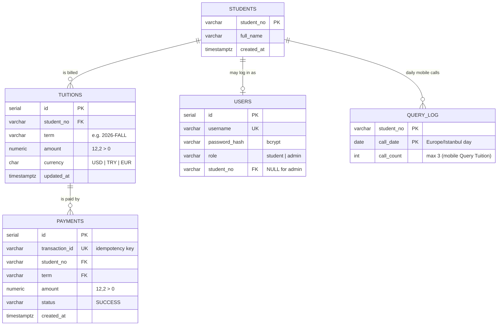

# ER / Data Model

Key constraints: `UNIQUE (student_no, term)` on `tuitions`, `UNIQUE (transaction_id)` on `payments`,
`FOREIGN KEY (student_no, term)` from `payments` to `tuitions`, and a CHECK that a `student` user is bound to a
student record while an `admin` is not. Balance = `tuitions.amount - SUM(payments.amount)` (computed, never stored).
